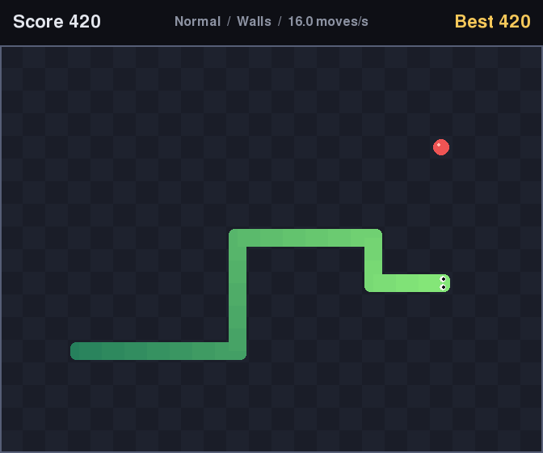

# Snake Game in Python

A Snake game I programmed in Python as an exercise to improve my programming skills. Steer the snake
around the board, eat food to grow and score points, and avoid hitting the walls or yourself. The snake
speeds up as it grows, there are three difficulty levels plus an optional wrap-around mode, and your best
score for each mode is saved between sessions. The game rules are written as plain Python with no
dependency on pygame, which keeps them easy to reason about and fully unit-tested.

## Screenshot



The image is rendered headlessly from the real drawing code by `scripts/screenshot.py`.

## Features

- Classic grid-based Snake on a 24 x 18 board, drawn with [pygame-ce](https://pyga.me/)
- Title, pause and game-over screens
- Speed increases with every piece of food, up to a per-difficulty cap
- Three difficulty levels (Easy, Normal, Hard) with different speed curves and score multipliers
- Wrap-around mode: the snake leaves one edge and reappears on the opposite side (the board border turns
  blue in this mode)
- Persistent high scores in a small JSON file, tracked separately for each difficulty and wall mode
- Buffered input: up to two turns are queued per step, so a quick "up then left" U-turn works as intended
  instead of reversing the snake into its own neck
- Pauses automatically when the window loses focus
- A "win" state if you manage to fill the entire board

## Controls

| Screen    | Key                          | Action                        |
|-----------|------------------------------|-------------------------------|
| Title     | Left / Right (or A / D)      | Change difficulty             |
| Title     | M                            | Toggle solid walls / wrap     |
| Title     | Enter or Space               | Start                         |
| Title     | Esc                          | Quit                          |
| Playing   | Arrow keys or W A S D        | Steer                         |
| Playing   | P or Esc                     | Pause                         |
| Paused    | P or Space                   | Resume                        |
| Paused    | Esc                          | Back to title                 |
| Game over | Enter or Space               | Play again                    |
| Game over | Esc                          | Back to title                 |

## Project structure

```
Snake-Game-in-Python/
├── snake/
│   ├── __main__.py     # Command-line entry point (python -m snake)
│   ├── app.py          # pygame window, event loop, timing, screen flow
│   ├── config.py       # Board size, layout and difficulty presets
│   ├── highscore.py    # JSON-backed high score store
│   ├── logic.py        # Pure game rules: snake, food, collisions, scoring
│   └── render.py       # All drawing: board, snake, HUD, overlays
├── scripts/
│   └── screenshot.py   # Renders docs/screenshot.png without opening a window
├── tests/              # pytest suite (logic, high scores, headless app tests)
├── docs/screenshot.png
├── Makefile
├── requirements.txt
└── requirements-dev.txt
```

### How it fits together

- **`logic.Game`** holds the whole simulation: the snake body (a deque, head first, plus a set of occupied
  cells for constant-time collision checks), the food position, score and a small queue of pending turns.
  `Game.step()` advances one cell and returns what happened (`MOVED`, `ATE`, `DIED` or `WON`). It knows
  nothing about pixels, keys or time.
- **`app.SnakeApp`** translates key presses into `queue_turn()` calls and menu actions, and converts
  wall-clock time into game steps with a fixed-timestep accumulator. Rendering runs at 60 FPS while the
  snake moves at `game.speed` steps per second, so speed changes never affect frame rate.
- **`render.Renderer`** only reads state and draws it, so the look can change without touching the rules.
- **`highscore.HighScoreStore`** loads scores once and writes them atomically (temp file, then rename)
  whenever a record is beaten. A missing or corrupt file is treated as "no scores yet".

A few rules worth knowing:

- Turns are validated against the last *queued* direction, not the current one. Reversals and repeated
  directions are ignored, and the queue holds at most two turns so stale presses cannot pile up.
- Moving into the cell the tail is about to leave is allowed, because the tail moves on the same step.
  If the snake is growing on that step the tail stays put, so the move is fatal.
- Food is placed uniformly at random on a free cell. The random source can be seeded, which the tests use
  to make games reproducible.

## Tech stack

- Python 3 (tested with Python 3.14; the code uses nothing newer than 3.10)
- pygame-ce 2.5.8, the community edition of pygame, chosen because it ships prebuilt wheels for current
  Python versions
- pytest for tests

## Getting started

```bash
git clone https://github.com/Omith786/Snake-Game-in-Python.git
cd Snake-Game-in-Python
python3 -m venv .venv
source .venv/bin/activate
pip install -r requirements-dev.txt   # or requirements.txt if you do not need the tests
```

Or, with `make`:

```bash
make install
```

## Usage

```bash
python -m snake                      # Normal difficulty, solid walls
python -m snake --difficulty hard    # start on Hard
python -m snake --wrap               # start in wrap-around mode
python -m snake --highscore-file ./my_scores.json
```

Difficulty and wall mode can also be changed on the title screen.

### High scores

Scores are stored in `~/.snake_highscores.json` by default, keyed by mode, for example:

```json
{
  "hard-walls": 180,
  "normal-walls": 340,
  "normal-wrap": 520
}
```

Set `SNAKE_HIGHSCORE_FILE` or pass `--highscore-file` to use another location. Any file ending in
`highscores.json` is gitignored, so a score file kept inside the project will not be committed.

### Scoring and speed

Each piece of food is worth 10 points multiplied by the difficulty's multiplier.

| Difficulty | Start speed (moves/s) | Increase per food | Max speed | Points per food |
|------------|-----------------------|-------------------|-----------|-----------------|
| Easy       | 6                     | +0.25             | 12        | 10              |
| Normal     | 8                     | +0.4              | 16        | 20              |
| Hard       | 11                    | +0.6              | 22        | 30              |

These presets live in `snake/config.py` and are easy to tweak.

## Testing

```bash
make test
# or
SDL_VIDEODRIVER=dummy SDL_AUDIODRIVER=dummy python -m pytest -q
```

The suite covers movement, growth, wall and self collisions, wrap-around, the tail-chasing edge case,
input buffering (including the fast U-turn case), speed scaling, the board-full win condition, high score
persistence and corrupt-file handling. Screen flow, timing and rendering are tested against an off-screen
surface with SDL's dummy video driver, so no window opens.

To regenerate the screenshot:

```bash
make screenshot
```

## Possible future work

- Sound effects for eating and crashing
- Obstacles or maze layouts loaded from simple text files
- Smooth interpolated movement between cells instead of cell-by-cell steps
- A top-ten leaderboard with player names rather than a single best score per mode
- An AI player (for example breadth-first search towards the food) as a demo mode

## Licence

Released under the [MIT Licence](LICENSE).
